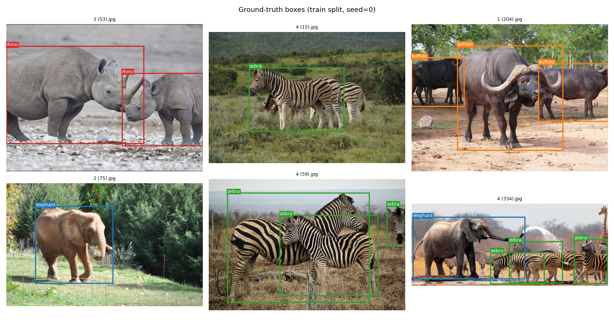
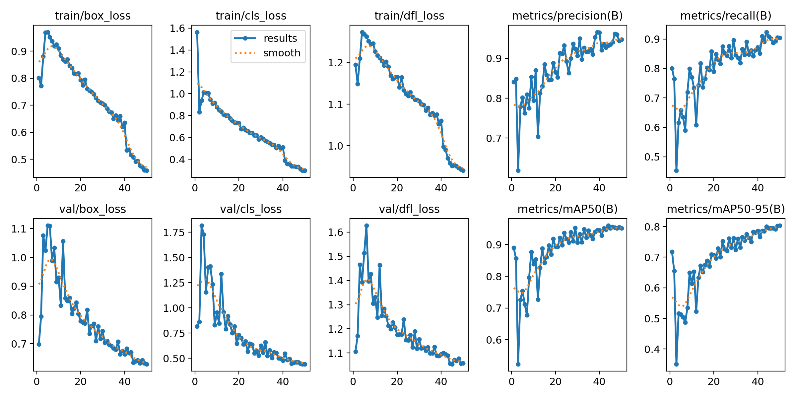
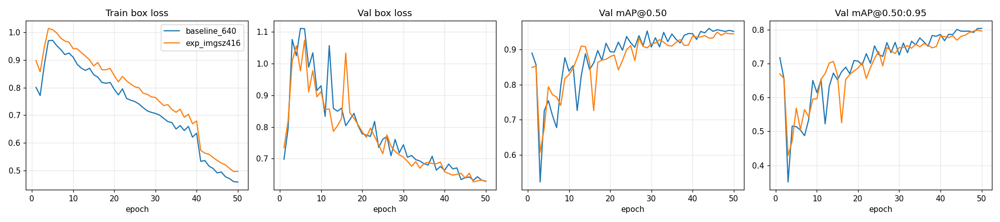
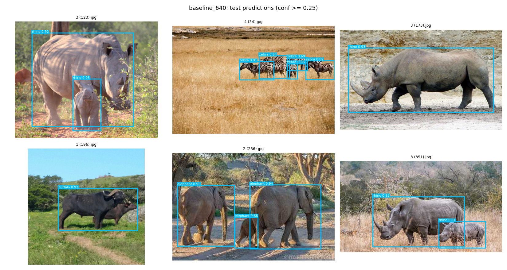

# African Wildlife Object Detection with YOLO11n

**CSCI1409 Deep Learning, Bonus Project (Fall 2026)**
Author: Yeskendir Ussibaliyev, student ID 23B031163

[](https://colab.research.google.com/github/eskendir2006/detection-model/blob/main/notebooks/object_detection_colab.ipynb)

## 1. Task

Detect and localise four African animals (**buffalo, elephant, rhino, zebra**) in photos.
The model draws a bounding box around each animal and labels it with a class.
I fine-tune a COCO-pretrained **YOLO11n** detector with the
[Ultralytics](https://github.com/ultralytics/ultralytics) framework and run one controlled
experiment: input image size **640 vs 416**.
The whole pipeline runs from a fresh Google Colab runtime with one notebook.

## 2. Repository structure

```
notebooks/object_detection_colab.ipynb   end-to-end Colab notebook (setup -> data -> train -> eval -> predictions)
configs/baseline.yaml                    run 1 hyper-parameters (imgsz 640)
configs/exp_imgsz416.yaml                run 2: identical except imgsz 416
scripts/common.py                        paths, dataset download, label/IoU helpers
scripts/prepare_data.py                  download, duplicate check + fix, label checks, statistics, GT figure
scripts/train.py                         training + run_info.json (versions, GPU, time, best epoch) + log
scripts/evaluate.py                      P / R / mAP@0.50 / mAP@0.50:0.95 on val or test
scripts/compare_runs.py                  validation comparison table, run selection, learning curves
scripts/analyze_test.py                  test predictions figure, error typing, failure cases
requirements.txt                         pinned dependency versions
results/                                 committed evidence: stats, logs, curves, metrics, figures
```

`datasets/` and `runs/` (data and weights) are created by the scripts and are not stored in git.

## 3. How to run

**Google Colab (recommended, free T4 GPU):**
1. Click *Open in Colab* above.
2. `Runtime -> Change runtime type -> T4 GPU`.
3. `Runtime -> Run all`. A full run (both trainings) takes about 54 minutes.
   Set `QUICK_RUN = True` in the first cell for a 1-epoch smoke test.

**Locally** (CPU works for the smoke test only):
```bash
git clone https://github.com/eskendir2006/detection-model.git
cd detection-model
pip install torch torchvision          # pick the build for your machine from pytorch.org
pip install -r requirements.txt
python scripts/prepare_data.py --resolve-duplicates
python scripts/train.py --config configs/baseline.yaml
python scripts/train.py --config configs/exp_imgsz416.yaml
python scripts/evaluate.py --run baseline_640 --split val
python scripts/evaluate.py --run exp_imgsz416 --split val
python scripts/compare_runs.py --runs baseline_640 exp_imgsz416
python scripts/evaluate.py --run <selected run> --split test
python scripts/analyze_test.py
```

**Only predictions:** download the final checkpoint (section 9) and run section 9 of the notebook, or
```python
from ultralytics import YOLO
YOLO("best.pt").predict("your_image.jpg", imgsz=640, conf=0.25, save=True)
```

## 4. Dataset

| | |
|---|---|
| Name | African Wildlife (Ultralytics packaging) |
| Source | Original: Bianca Ferreira, [Kaggle: African Wildlife](https://www.kaggle.com/datasets/biancaferreira/african-wildlife). Packaged by Ultralytics: [docs](https://docs.ultralytics.com/datasets/detect/african-wildlife/), [zip](https://github.com/ultralytics/assets/releases/download/v0.0.0/african-wildlife.zip) |
| Usage terms | The Ultralytics zip includes `LICENSE.txt` = **GNU AGPL-3.0**. The original Kaggle release does not specify a license. The images are collected web photos; I use them only for non-commercial coursework and do not redistribute them (the notebook downloads them from the official URL). |
| Classes | 0 buffalo, 1 elephant, 2 rhino, 3 zebra |
| Annotation format | YOLO `.txt`: one line per object, `class x_center y_center width height`, normalised to [0, 1] |
| Size | 1,504 images, 2,685 boxes |

### 4.1 Splits and duplicate handling

The dataset ships with train/val/test splits (1,052 / 225 / 227 images). I checked for
**near-duplicates** by computing a perceptual hash (pHash, 64 bits, `imagehash`) of every
image and grouping images whose hashes differ by at most 5 bits.

* Found **62 near-duplicate groups**. **29 groups spanned two splits** (19 train-test,
  7 train-val, 3 other), i.e. the same photo appeared in train and in val/test.
  Example pairs: [`results/dataset/duplicate_pairs.png`](results/dataset/duplicate_pairs.png).
* Leaving them would leak training images into evaluation and inflate val/test scores.
* **Fix (deterministic, no random seed needed):** every duplicate group that spans splits is
  moved entirely into its earliest split (train < val < test). 29 images were moved
  ([`duplicate_moves.csv`](results/dataset/duplicate_moves.csv)). Re-running the check
  afterwards finds 0 cross-split groups. Duplicates *within* one split are kept.

Final splits used for all experiments (`results/dataset/dataset_stats.md`):

| Split | Images | Objects | buffalo | elephant | rhino | zebra |
|---|---:|---:|---:|---:|---:|---:|
| train | 1080 | 1978 | 416 | 565 | 410 | 587 |
| val | 218 | 366 | 86 | 87 | 82 | 111 |
| test | 206 | 341 | 52 | 96 | 67 | 126 |
| **total** | 1504 | 2685 | 554 | 748 | 559 | 824 |

### 4.2 Label quality check

`prepare_data.py` checks every label file for: missing or empty files, wrong number of
values, invalid class ids, coordinates outside [0, 1], boxes smaller than 4 px and duplicate
boxes. **Result: no issues found** ([`label_issues.csv`](results/dataset/label_issues.csv)).

Manual inspection of the ground-truth figure shows an issue the automatic check cannot detect:
**inconsistent box granularity**. In some images every animal in a group has its own box,
while in others (e.g. `4 (15).jpg`, zebras) one box covers several overlapping animals.
Animals outside the four classes (e.g. a giraffe in `4 (334).jpg`) are correctly unlabelled.
TODO: add anything else you notice.



## 5. Baseline training

| Setting | Value |
|---|---|
| Framework | Ultralytics **8.4.216**, PyTorch **TODO** (from `run_info.json`), Python **TODO** |
| Hardware | Tesla T4 |
| Model / initial weights | YOLO11n, `yolo11n.pt` (COCO-pretrained, ~2.6 M parameters) |
| Image size | 640 |
| Batch size | 16 |
| Epochs | 50 (no early stopping) |
| Optimizer / learning rate | SGD, lr0 = 0.01 -> 0.0001 (linear), momentum 0.937, weight decay 5e-4, 3 warm-up epochs |
| Augmentation | Ultralytics defaults (mosaic, HSV jitter, horizontal flip, scale/translate) |
| Random seed | 0 (`deterministic=True`) |
| Training time | 11.83 min |
| Checkpoint selection | `best.pt` = epoch with the highest **validation** mAP@0.50:0.95 (Ultralytics 8.4 fitness); best epoch 49/50 |

Config: [`configs/baseline.yaml`](configs/baseline.yaml) |
log: [`train_log.txt`](results/runs/baseline_640/train_log.txt) |
per-epoch metrics: [`results.csv`](results/runs/baseline_640/results.csv) |
all settings: [`run_info.json`](results/runs/baseline_640/run_info.json)



## 6. Controlled experiment: image size 640 -> 416

**Changed:** `imgsz` 640 -> 416. **Fixed:** data split, initial weights (`yolo11n.pt`), seed,
epochs, batch size, optimizer, learning-rate schedule, augmentation.

**Hypothesis (stated before training):** a 416 px input has about 2.4x fewer pixels than 640 px,
so training and inference will be noticeably faster. Recall and mAP@0.50 will drop slightly,
mostly for small/distant animals and crowded zebra herds, because those objects cover very few
pixels after downscaling.

Validation results (`results/comparison.md`; P/R at the max-F1 confidence, NMS IoU 0.7):

| Run | Changed setting | Val precision | Val recall | Val mAP@0.50 | Val mAP@0.50:0.95 | Best epoch | Training time (min) |
|---|---|---:|---:|---:|---:|---:|---:|
| baseline_640 | imgsz=640 | 0.945 | 0.907 | 0.953 | 0.803 | 50 | 16.3 |
| exp_imgsz416 | imgsz=416 | 0.939 | 0.906 | 0.946 | 0.796 | 49 | 11.8 |



**Explanation:** I believe that the hypothesis was basically confirmed. The most change in all of the classes is observed in the buffalo class, though the change is slight (0.03 at most). I consider the resolution change worth it as it cut the training time by 27%. Note that one
seed per setting cannot show whether a small difference (e.g. < 0.01 mAP) is real or noise.

**Selected run:** baseline_640 with mAP%0.50 of 0.953 (rule: higher validation mAP@0.50, see `results/selected_run.json`).

## 7. Final test results

The selected run's `best.pt` was evaluated **once** on the held-out test split, after the run
had been chosen using validation data only.

| Run | Test precision | Test recall | Test mAP@0.50 | Test mAP@0.50:0.95 |
|---|---:|---:|---:|---:|
| baseline_640 | 0.970 | 0.939 | 0.972 | 0.829 |

Evaluation settings: image size = training size, **confidence threshold 0.001**, **NMS IoU 0.7**,
a prediction matches a ground-truth box when **IoU >= 0.50** and the class is the same.
Per-class values: `results/eval/<run>_test.json`.

**What the metrics measure**
* **IoU (intersection over union)**: overlap of a predicted and a true box, area of overlap
  divided by area of union. IoU >= 0.5 counts as a correct localisation for mAP@0.50.
* **Precision** = TP / (TP + FP): of the boxes the model predicted, the fraction that are correct.
  Low precision means many false alarms.
* **Recall** = TP / (TP + FN): of the real animals, the fraction the model found.
  Low recall means many missed animals.
* **AP@0.50** for one class: the area under its precision-recall curve, obtained by sweeping the
  confidence threshold from high to low (that is why evaluation uses conf = 0.001).
  **mAP@0.50** is the mean of AP over the 4 classes. **mAP@0.50:0.95** averages mAP over IoU
  thresholds 0.50, 0.55, ..., 0.95, so it also rewards tight boxes.
* Ultralytics reports P and R at the confidence that maximises F1. At the fixed deployment
  threshold conf = 0.25 the analysis script gives precision **0.923** and recall **0.950**
  (`results/test_analysis/summary.json`).

## 8. Predictions and failure analysis

Test predictions (conf >= 0.25; blue = correct, red = error with its type):



`analyze_test.py` matches predictions to ground truth (IoU >= 0.5, same class) and labels every
error as *missed*, *wrong class*, *duplicate*, *poor localisation* or *background* false positive.
# Failure cases: baseline_640 on test (conf >= 0.25, match IoU >= 0.5)

Error totals: {'missed': 17, 'wrong_class': 2, 'duplicate': 2, 'localization': 13, 'background': 10}

## Failure 1: missed


**2 (130).jpg**: 10 ground-truth object(s) (elephant, elephant, elephant, elephant, elephant, elephant, elephant, elephant, elephant, elephant), 8 prediction(s), 7 correct.
- missed 3 x **elephant**
- localization false positive: **elephant** (0.49), best IoU with a same-class object 0.43

Likely cause: The target is at the edge, slightly out of sight. The missed elephant is also overlapped with other creatures.

## Failure 2: wrong_class


**4 (257).jpg**: 2 ground-truth object(s) (zebra, zebra), 1 prediction(s), 0 correct.
- missed 2 x **zebra**
- predicted **buffalo** (0.69) on a **zebra** (wrong class)

Likely cause: The model misrepresented a pair of zebras due to their close proximity.

## Failure 3: false_positive


**4 (105).jpg**: 2 ground-truth object(s) (zebra, zebra), 5 prediction(s), 2 correct.
- background false positive: **elephant** (0.75), best IoU with a same-class object 0.0
- background false positive: **elephant** (0.45), best IoU with a same-class object 0.0
- background false positive: **elephant** (0.25), best IoU with a same-class object 0.0

Likely cause: The dataset does not contain such animals, so the springboks on the photo were randomly labeled.

**Practical next step:** To attempt training with a higher resolution images. I believe that this would eliminate most cases of missed animals.

(File names of the failure figures depend on which error types occur; check `results/test_analysis/`.)

## 9. Final checkpoint

Download: `https://github.com/eskendir2006/detection-model/releases/download/v1.0/best.pt`
(run: baseline_640 , image size ~5 MB). It is attached to the GitHub Release `v1.0` and not
committed to git.

## 10. Limitations

* One training run per setting (seed 0). Differences smaller than run-to-run noise cannot be
  separated from chance; several seeds would be needed.
* Web-collected images: mostly clear, centred, daytime photos. No camera-trap, night or aerial
  images, so performance in real wildlife monitoring is likely lower.
* Duplicates were detected with a perceptual-hash threshold (<= 5 bits). Edited near-duplicates
  (heavy crops, mirrored photos) can still slip through.
* Labelling granularity is inconsistent (group boxes vs individual boxes), which affects both
  training and the measured recall for herds.
* Small test set (206 images, 52 buffalo boxes): per-class test metrics have high variance.

## 11. Credits and use of assistance

* Detection framework and pretrained weights: [Ultralytics YOLO](https://github.com/ultralytics/ultralytics) (AGPL-3.0).
* Dataset: Bianca Ferreira (Kaggle), packaged by Ultralytics.
* My additions: all code in `scripts/` (duplicate detection and split repair, label checks,
  run logging, comparison, error typing and failure analysis), the configs, the notebook and
  this README. Training/evaluation themselves call the Ultralytics API.
* AI assistance: the repository scaffolding and scripts were drafted with the help of
  Claude (Anthropic) as a coding assistant. I reviewed, ran and understand all of the code,
  chose the experiment and wrote the analysis.
