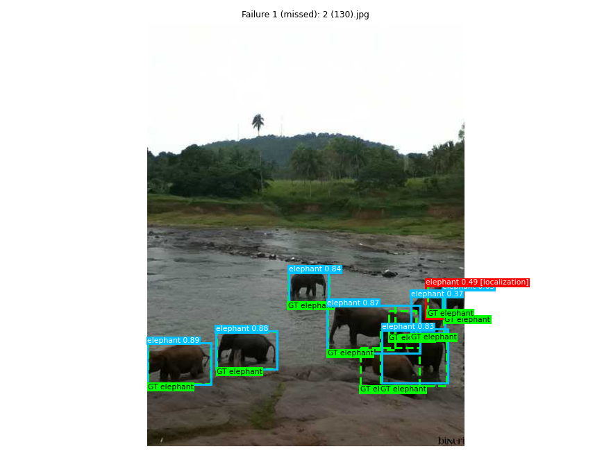
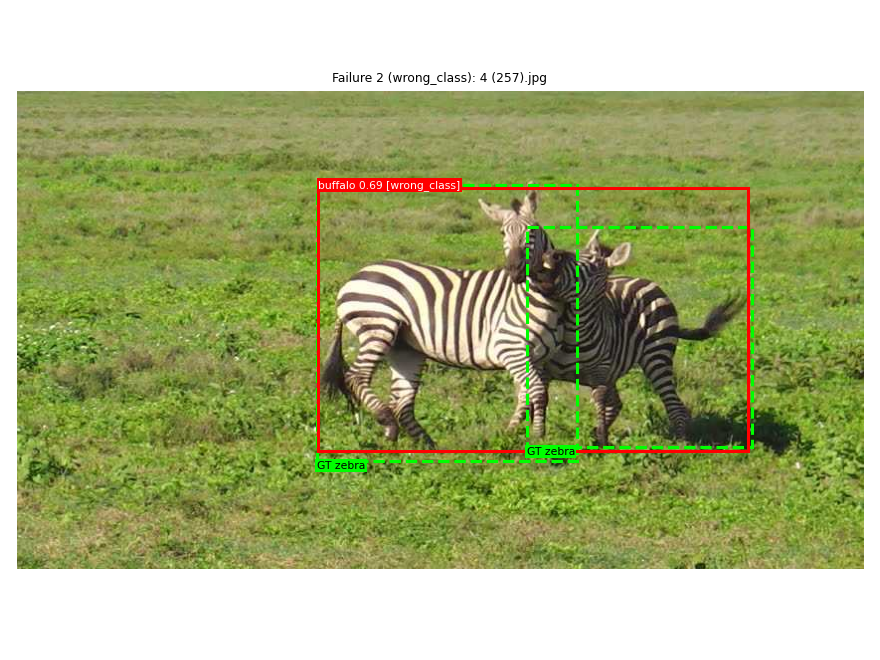
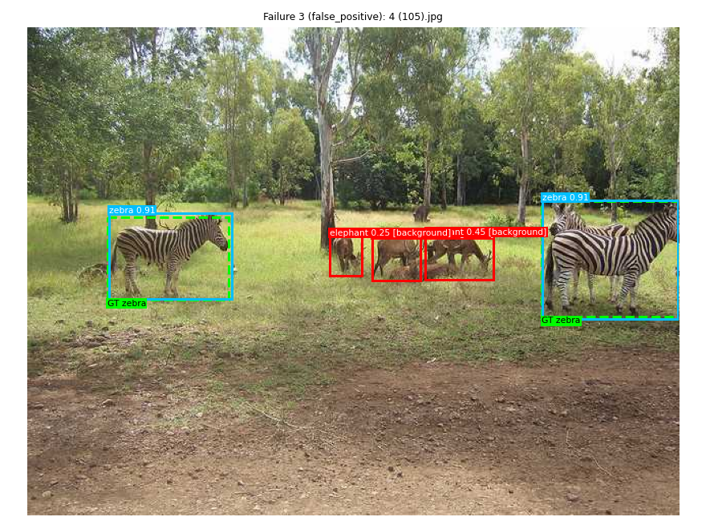

# Failure cases: baseline_640 on test (conf >= 0.25, match IoU >= 0.5)

Error totals: {'missed': 17, 'wrong_class': 2, 'duplicate': 2, 'localization': 13, 'background': 10}

## Failure 1: missed

**2 (130).jpg**: 10 ground-truth object(s) (elephant, elephant, elephant, elephant, elephant, elephant, elephant, elephant, elephant, elephant), 8 prediction(s), 7 correct.
- missed 3 x **elephant**
- localization false positive: **elephant** (0.49), best IoU with a same-class object 0.43

Likely cause: The target is at the edge, slightly out of sight. The missed elephant is also overlapped with other creatures.

## Failure 2: wrong_class

**4 (257).jpg**: 2 ground-truth object(s) (zebra, zebra), 1 prediction(s), 0 correct.
- missed 2 x **zebra**
- predicted **buffalo** (0.69) on a **zebra** (wrong class)

Likely cause: The model misrepresented a pair of zebras due to their close proximity.

## Failure 3: false_positive

**4 (105).jpg**: 2 ground-truth object(s) (zebra, zebra), 5 prediction(s), 2 correct.
- background false positive: **elephant** (0.75), best IoU with a same-class object 0.0
- background false positive: **elephant** (0.45), best IoU with a same-class object 0.0
- background false positive: **elephant** (0.25), best IoU with a same-class object 0.0

Likely cause: The dataset does not contain such animals, so the springboks on the photo were randomly labeled.
